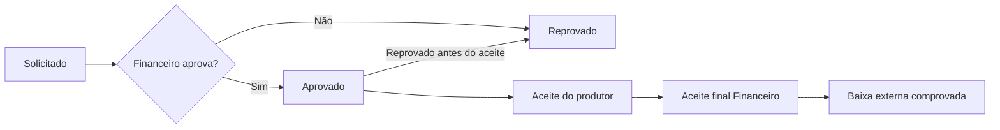

# Arquitetura financeira — Pacote 02

## Camadas

- **Interface:** `src/components/financeiro/` — dashboards e formulários protegidos por perfil; rotas em `src/app/(workspace)`.
- **API:** Route Handlers `src/app/api/financeiro/*` (somente interno), `src/app/api/repasses/*` (interno e produtor, com filtro de escopo), `src/app/api/titulos/[id]/liquidar` (somente interno).
- **Regras de negócio:** `src/lib/operations.ts` controla saldos, reservas, estados e baixas; `src/lib/split-calculation.ts` calcula valores de maneira pura em centavos.
- **Persistência:** `prisma/schema.prisma` SQLite e `prisma/postgresql/schema.prisma` PostgreSQL; sem duplicação de regras entre portais.

## Modelo de dados novo

| Entidade | Papel |
| --- | --- |
| `Gateway` | Cadastro de adquirente/processador |
| `CardBrand` | Bandeira/modalidade de pagamento |
| `MdrRule` | Percentual em pontos-base, fixo/transação, adquirente, bandeira e parcelas |
| `EventFeePolicy` | Taxa da Disk por evento e responsável pelo MDR |
| `FinancialSale` | Venda registrada, snapshot de bruto, taxa, MDR, split, recebível e status |
| `PayoutRequest` | Repasse/antecipação, reserva, aprovação, aceite do produtor, aceite final, comprovante e baixa |
| `FinancialTitle` | Recebível interno automático gerado por venda |
| `LedgerEntry` | Crédito ao liquidar recebível e débito ao registrar baixa externa de payout |
| `AuditLog` | Trilha de operação e ator autenticado |

As colunas monetárias são BigInt em centavos, e a apuração usa cálculos inteiros para que o split seja exato. Recebíveis do gateway (ativo bancário) não são tratados como receita própria da Disk; a dívida com produtor fica contabilizada como obrigação por evento.

## Estados de solicitação

A criação reserva o direito apurado; reprovação devolve a capacidade. Após o aceite financeiro final, a operação permanece aguardando baixa até que o usuário interno registre o pagamento externo previamente efetuado, com referência exclusiva. A confirmação lança o débito no razão da conta e grava evidência no log. **Não existe integração bancária de saída.**

## Permissões

| Ação | Admin | Financeiro Disk | Produtor |
| --- | :---: | :---: | :---: |
| Criar gateways, MDR e taxa Disk | Sim | Sim | Não |
| Cadastrar e liquidar venda/recebível interno | Sim | Sim | Não |
| Ver custos, MDR, taxa Disk e receita própria da Disk | Sim | Sim | Não |
| Consultar direitos do próprio evento | Sim (todos) | Sim (todos) | Sim (seus eventos) |
| Solicitar repasse ou antecipação | Sim | Sim | Sim (seus eventos) |
| Aprovar ou reprovar | Sim | Sim | Não |
| Aceitar como produtor | Não | Não | Sim (do produtor vinculado) |
| Registrar aceite final Financeiro | Sim | Sim | Não |
| Registrar baixa de transferência externa | Sim | Sim | Não |
| Consultar auditoria interna detalhada | Sim | Não | Não |

Em cada endpoint, a autorização é feita no servidor com sessão; a restrição visual do menu é adicional, não a única barreira.

## Restrições para homologação

1. Migração Prisma revisada (evitar `db push` diretamente em banco de produção), backup testado, configuração de PostgreSQL e pool de conexões.
2. Testes de transações sob concorrência, autorização multiusuário, reversões, reconciliações bancárias reais e segregação de funções.
3. Integrações via webhook assinado, importação por lotes com idempotência e validação do identificador de vendas no sistema oficial.
4. Implementação futura de estornos/chargebacks que reduzam obrigações e controlem saldos já comprometidos.
5. Aprovação de crédito/risco, juros/encargos, limites de exposição para antecipações e auditoria reforçada.
6. Provedor certificado para assinaturas digitais de documentos quando exigido juridicamente; aceite aqui é apenas trilha eletrônica simples.

## Estado de verificação

- 2026-10-19: verificação sintática TypeScript/TSX e execução isolada de teste de matemática com TypeScript global realizadas.
- **Pendente:** instalar dependências, gerar cliente Prisma, validar esquemas, rodar `npm run typecheck`, `npm test`, `npm run build`, iniciar aplicação e executar testes de integração no banco.
